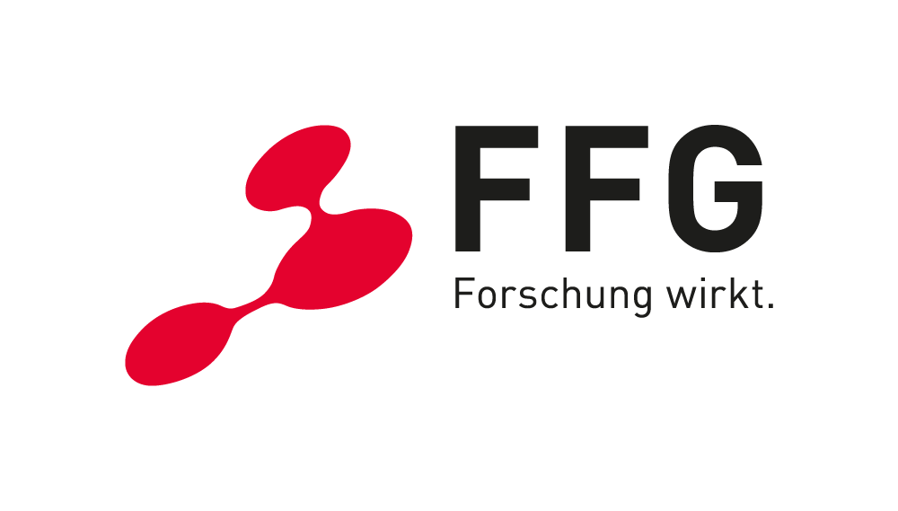

# Assessing Robustness of Object Detection

It is the aim to evaluate the robustness of object detection by modifying a sample, in particular, by occluding parts of the object. 

## Basic Workflow
This script reads an input image, detects an object in it and then occludes the object iteratively while trying to re-detect the object.
A line graph is returned with the detection score (y-axis) over the increasing occlusion (x-axis). This basic concept is applied to all
input images found in a folder and a line for each input image is drawn finally in the same line graph for convenient comparison.
The script depends on an object detector, which returns a detection score for the wanted object ("label of interest") plus bounding box and 
a score image, where each pixel's value describes the likelihood of being part of the object. 

## Occlusion approaches
Three approaches of how the object is occluded are available:

* Dino patch
* Region
* Left to right

### Dino patch
In order to evaluate an object template's set robustness the script tries to mask out iteratively the object's pixels, starting from the most important to the
least important pixels, according to DINOv2/v3 features. Importance of object pixels is assumed to correlate with the score values.
The script loops several times and looks in each loop for the maximum score value. As
a single score value corresponds to a bigger image patch in the input image (e.g. 16x16 downsampling in the reference implementation), the whole corresponding patch in the input image 
is set to black. Then the object detector is called again, which returns again a score image and a detection score for the wanted object.
By re-using the input image of the last loop and masking of additional image patches, the object fades out after a few loop cycles.
The object detection score value of each loop cycle is drawn in the line graph on the y-axis whereas the amount
of occlusion is used on the x-axis. The amount of occlusion is computed as the fraction of black pixels in relation to the object's pixel amount (bounding box size).
As the maximum score values may not be neighbours in the input image, the object is masked out at different locations, it is not a region growing approach.

### Region
This approach is similar to Dino patch, in contrast here the returned score image values are mapped to range [0,255] and finally quantized, the number
of quantization levels is arbitrary, e.g. score values mapped to values 0,1,2 are set to 0, if the number of quantization levels is set to 3.
The overall workflow remains the same as in Dino patch: At each loop cycle the input image is modified by setting those image patch regions
to black, where the score values in the quantized score image were a maximum. This approach needs less loop cycles as the object fades out faster
due to the union of all pixel score values belonging to the same quantization level.

### Left to Right
"L2R" initially takes the object's bounding box of the initial object detection performed with the original input image. Then the script
fades out the object iteratively by drawing black vertical lines starting at the left side of the object detection's bounding box. This
object occlusion strategy tries to simulate rudimentarily occlusion like in a real world scenario, when a background object gets hidden
by another - probably moving - foreground object.

### Global summary
The workflow above started with reading an input image and evaluated the object template's robustness based on this input image. Accordingly
for each input image a single line is drawn in a line chart. Instead of a single input image the script reads in all images found in a folder and
outputs a line in the line chart. It is assumed that all input images in the same folder belong to the same object. A "summary" option 
supports a summarization of all these curves to a single one. It sums up in how many templates an object can still be detected (y-axis) 
over the object occlusion (x-axis). This allows feedback about the object template set's robustness as a whole.

## 3rd party object detector integration
In the deployed reference implementation an object detector has been used, which uses DINOv3 features. As this script is not deployed with the reference object detector,
an interface has been added to integrate any other custom object detector, it is the script user's responsibility to integrate an object detector as described.
More details can be found in the script.
Any object detector used in this script has to fulfill three basic requirements, it is assumed that any object detector returns
* a detection score and the 
* detected object's bounding box and
* a score image where each pixel's value is the score belonging to the wanted detected object. 
The score may be understood as "confidentiality" or "probability" but the score values are not limited to typical probability range [0,1], they may simply
follow the rule "the higher, the more likely" the object. The reference object detector rasterizes the input
image into 16x16 sized patches fitting for DINO v3 features and assigns each patch a value of likelihood belonging to the wanted object. 
This projection of a DINO v3 patch size (16x16) to a single value equals a downsampling of the input image and ends in a smaller score 
image (downsampled by factor 16). This means for integration of a 3rd party object detector that the returned score image may be of much
smaller size than the original input image. Scaling between output score image and input image is done automatically by the script.
In order to implement a 3rd party object detector, only two method interfaces in "CustomObjectDetectionService.py" have to be 
implemented.

## License

See [LICENSE](LICENSE).

## Acknowledgement

This work is a result of the project FAIR-AI, which is funded by the Austrian Research Promotion Agency (FFG) as part of Artificial Intelligence Mission Austria (AIM AT) from funds of the Austrian Federal Ministry of Innovation, Mobility, and Infrastructure.

  
  
  

